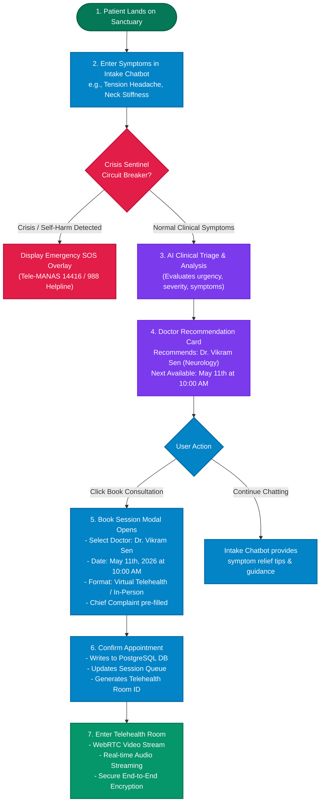
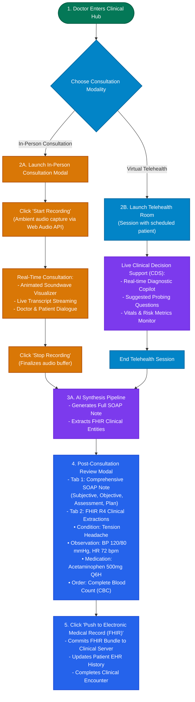
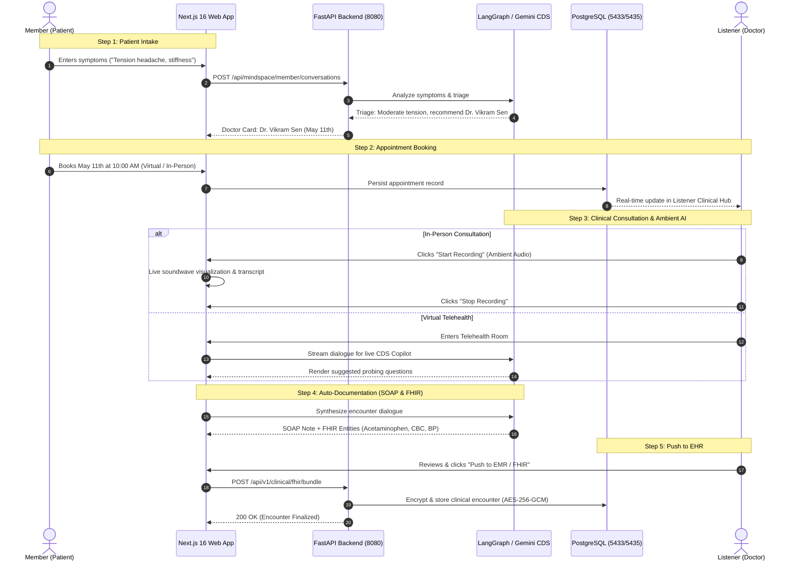

# 🏛️ MindSpace / SevaHealth AI — System Architecture & Workflow Specifications

This document defines the architectural patterns, Clean Architecture layer mappings, and end-to-end operational workflows for both **Member (Patient/Citizen)** and **Listener (Doctor/Clinician)** personas.

**File Location:** `docs/ARCHITECTURE.md`

---

## 📐 1. Clean Architecture Paradigm

Both the frontend and backend follow Clean Architecture to ensure strict decoupling of business rules from UI frameworks, database engines, and external AI models.

```
       ┌─────────────────────────────────────────────────────────────┐
       │             Presentation Layer (UI / API)                   │
       │   - Next.js Views & Modals (React 19)                       │
       │   - FastAPI Routers & WebSockets                            │
       └──────────────────────────────┬──────────────────────────────┘
                                      │ calls
                                      ▼
       ┌─────────────────────────────────────────────────────────────┐
       │             Application Layer (Use Cases)                   │
       │   - Consultation Workflow Orchestrator                      │
       │   - Matching Engine & Peer State Machine                    │
       │   - SOAP Note Synthesis & FHIR Extraction Pipeline          │
       └──────────────────────────────┬──────────────────────────────┘
                                      │ executes
                                      ▼
       ┌─────────────────────────────────────────────────────────────┐
       │             Domain Layer (Core Entities & Rules)            │
       │   - Patient Profile, Doctor Entity, Appointment Schedule    │
       │   - SOAPNote, FHIRResourceBundle, ClinicalObservation       │
       │   - Crisis Sentinel Safety Rules (Deterministic)            │
       └──────────────────────────────▲──────────────────────────────┘
                                      │ implements
                                      │
       ┌──────────────────────────────┴──────────────────────────────┐
       │             Infrastructure Layer (Adapters & I/O)           │
       │   - PostgreSQL 16 (Ports 5433 & 5435) via SQLAlchemy/Prisma │
       │   - AES-256-GCM Envelope Encryption Storage                 │
       │   - Multi-Agent Voice Service (LangGraph, Sarvam AI)        │
       │   - External EMR / FHIR Server Connectors                   │
       └─────────────────────────────────────────────────────────────┘
```

### Layer Rules:
1. **Domain Layer:** Pure TypeScript / Python models with zero external third-party dependencies. Defines core business entities (`MemberQueue`, `ConsultationSession`, `SOAPRecord`, `FHIRBundle`).
2. **Application Layer:** Encapsulates business use cases. Coordinates domain entities and triggers infrastructure interfaces.
3. **Infrastructure Layer:** Implements database persistence, network clients, cryptographic envelopes, and AI provider integrations.
4. **Presentation Layer:** Renders the user interface and serves REST/WebSocket endpoints. Depends only on the Application and Domain layers.

---

## 👤 2. Member (Patient/Citizen) Workflow Architecture

The Member experience guides the user from symptom entry to clinical consultation:



---

## 🩺 3. Listener (Doctor/Clinician) Workflow Architecture

The Listener dashboard supports dual modalities: **Virtual Telehealth** and **In-Person Ambient AI Capture**:



---

## 🔄 4. Unified End-to-End System Integration



---

## 🗄️ 5. Database & Security Architecture

1. **Envelope Encryption (AES-256-GCM):**
   - Health journals, clinical notes, and private conversations are encrypted with individual data encryption keys (DEK).
   - Key encryption keys (KEK) are managed securely by the backend key management service.
2. **Dual PostgreSQL Architecture:**
   - **Port 5433 (`mindspace-postgres`):** Core health records, peer matching queues, clinical encounters, and FHIR resources.
   - **Port 5435 (`mindspace-frontend-postgres`):** Local user profiles, sessions, and Prisma application state.
3. **FHIR R4 Standardized Resources:**
   - `Condition`: Diagnoses and chief complaints.
   - `Observation`: Vital signs (blood pressure, heart rate, temperature).
   - `MedicationRequest`: Prescriptions and dosages.
   - `ServiceRequest`: Laboratory orders and diagnostic imaging.
