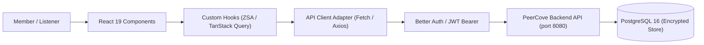

# PeerCove — Frontend Application Architecture

[-black)](https://nextjs.org/)
[](https://react.dev/)
[](https://blog.cleancoder.com/uncle-bob/2012/08/13/the-clean-architecture.html)

This document describes the architectural design, module layout, and state management conventions of the **PeerCove** frontend application.

---

## 🏛️ Clean Module Layout (`src/modules`)

The frontend application adopts a domain-driven Clean Architecture structure inside `src/`:

```
frontend/src/
├── app/                        # Delivery Layer: Next.js 16 App Router pages, layouts & route handlers
│   ├── api/                    # Serverless API routes (auth, workflow, speech, status)
│   └── [locale]/               # Internationalized localized routing (/en, etc.)
│       ├── (auth)/             # Authentication flows (login, signup, forgot-password)
│       ├── (marketing)/        # Public landing pages & educational content
│       └── (peercove)/        # PeerCove Core Role Workspaces
│           └── peercove/
│               ├── member/     # Member Wellbeing Sanctuary & sub-routes (consultation, goals, journal, mood)
│               ├── listener/   # Volunteer Listener Hub & sub-routes (members, profile)
│               ├── listener-supervisor/ # Supervisor Sanctuary & sub-routes (conduct-reports, listeners, training-reviews)
│               ├── safety-operations/   # Emergency crisis triage & safety incident desk
│               └── platform-administrator/ # Platform admin, zero-knowledge controls & audit logs
│
├── components/                 # Presentation Layer: Reusable atomic design components
│   ├── ui/                     # Design system primitives (button, dialog, input, card)
│   └── common/                 # Shell layouts, navigation sidebars, and headers
│
├── modules/                    # Application / Domain Use Case Modules
│   ├── client/peercove/       # Client-side domain modules:
│   │   ├── member/             # Member feature logic:
│   │   │                       #   - Mood trackers & trajectory charts
│   │   │                       #   - AES-256 encrypted private journal
│   │   │                       #   - Guided self-help & reflections
│   │   │                       #   - Consultation room with somatic breathing pacer
│   │   ├── listener/           # Listener feature logic:
│   │   │                       #   - Match offer review & acceptance
│   │   │                       #   - Real-time peer-to-peer chat interface & SOAP notes
│   │   │                       #   - Availability scheduling & capacity controls
│   │   ├── supervisor/         # Supervision & quality governance:
│   │   │                       #   - Pod roster & listener eligibility oversight
│   │   │                       #   - Conduct report review & resolution audits
│   │   │                       #   - Training verification & pod check-ins
│   │   ├── safety/             # Safety & crisis response:
│   │   │                       #   - Emergency escalation triage desk
│   │   │                       #   - Tele-MANAS, AASRA, 112/988 emergency integration
│   │   ├── admin/              # Platform administration:
│   │   │                       #   - Zero-Knowledge mode toggle & KMS telemetry
│   │   ├── companion/          # Voice & conversational grounding companion
│   │   └── intake/             # Conversational intake & screener questionnaires
│   └── server/peercove/       # Server-side domain integration:
│       ├── api-client.ts       # Type-safe HTTP REST client for Core API (Port 8080)
│       ├── member-dashboard.ts # Server-side data fetchers for member dashboard
│       ├── role-dashboards.ts  # Role aggregation services for staff dashboards
│       └── role-guard.ts       # RBAC role assertion & navigation guards
│
├── hooks/                      # Interface Adapters: TanStack React Query & custom domain hooks
├── lib/                        # Infrastructure: API client, Better Auth integration, utils
├── providers/                  # Application Contexts: Theme, Auth, QueryClient, Toast
└── types/                      # Domain interfaces, API schemas, and DTOs
```

---

## 🔄 Data Flow & State Management



1. **Server vs. Client Components**:
   - Layouts, static content, and initial data prefetching are rendered via **Server Components**.
   - Interactive widgets (chat interfaces, voice widgets, mood dials) run as **Client Components** (`'use client'`).
2. **Data Fetching & Cache**:
   - Asynchronous server data is queried and cached via **TanStack React Query**.
   - Mutations trigger targeted query invalidation to update dashboards in real-time.
3. **Real-time Audio & Chat**:
   - Audio streaming connects directly to **LiveKit WebRTC** / **Vapi** servers.
   - Text chat updates via WebSocket / Server-Sent Events (SSE) connected to the backend API.

---

## 🔒 Security & Privacy in the Frontend

1. **Zero Client Storage of Sensitive Disclosures**:
   - Member journal entries, intake reflections, and chat messages are never cached in unencrypted `localStorage` or `sessionStorage`.
2. **Ephemeral Voice Processing**:
   - Audio input streams directly through WebRTC in memory.
   - No audio buffers are written to browser storage.
3. **Owner-Scoped JWT Protection**:
   - All API requests attach a bearer token verified by the backend against the PeerCove JWKS provider.
